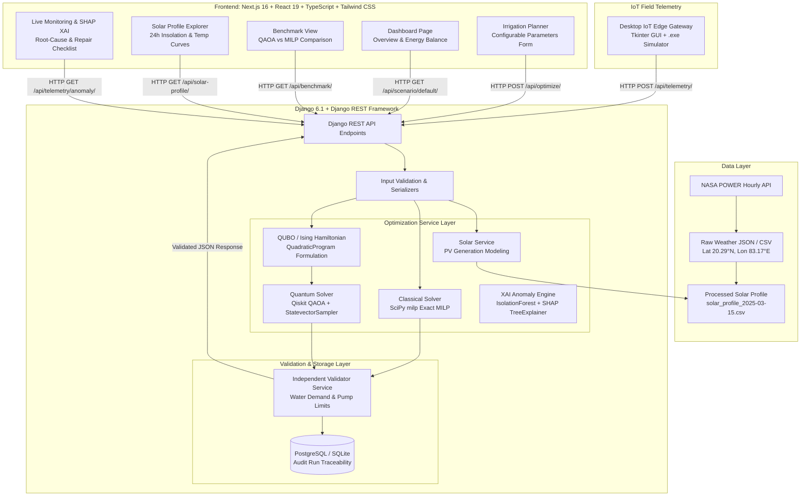

# Arcade
VTU-QFF-HC-0081 | Tier: Online

| Field | Details |
| :--- | :--- |
| **Team** | Arcade |
| **Team ID** | VTU-QFF-HC-0081 |
| **Tier** | Online |
| **Repository** | [vtu-hc-arcade](https://github.com/vtu-qiskit-fall-fest-2026/vtu-hc-arcade.git) |
| **Organisation** | [vtu-qiskit-fall-fest-2026](https://github.com/vtu-qiskit-fall-fest-2026) |
| **Event** | VTU-QFF Hackathon — VTU-Qiskit Fall Fest 2026 |
| **Live Web App** | [https://q-irrigate.vercel.app/](https://q-irrigate.vercel.app/) |
| **Backend API** | [https://q-irrigate-backend.onrender.com/api/](https://q-irrigate-backend.onrender.com/api/) |

> ### 🌐 Live Production Deployment
> 🚀 **Live Agricultural Web Dashboard**: [https://q-irrigate.vercel.app/](https://q-irrigate.vercel.app/)  
> ⚙️ **Live Backend REST API**: [https://q-irrigate-backend.onrender.com/api/](https://q-irrigate-backend.onrender.com/api/)

---

## 📌 Table of Contents
- [Team Members](#-team-members-github-ids)
- [Problem Statement](#-problem-statement)
- [Proposed Solution](#-proposed-solution)
- [Approach & Architecture](#-approach--architecture)
- [Tech Stack](#️-tech-stack)
- [Project Structure](#-project-structure)
- [How to Run](#-how-to-run)
- [How to Push Code](#-how-to-push-code)
- [Submission Checklist](#-submission-checklist)
- [Resources](#-resources)
- [License](#-license)

---

## 👥 Team Members (GitHub IDs)
Members are added to this repository as collaborators and must accept the GitHub invitation before they can push. Add your GitHub username below.

| # | Name | GitHub Username | Role |
| :-: | :--- | :--- | :--- |
| **1** | Chhayakanta Maharana | [Chhayakanta-Maharana](https://github.com/Chhayakanta-Maharana) | Team Lead |
| **2** | Hari Pangi | [Hari92204](https://github.com/Hari92204) | Developer |
| **3** | N/A | N/A | N/A |

---

## ❓ Problem Statement

- **Problem**: Agricultural irrigation pumping is one of the largest drivers of rural grid electricity consumption and operational expenses for farmers across India. Water pumps are frequently operated during peak-tariff hours or under carbon-intensive thermal grid power despite abundant daytime solar irradiance, while coordinating multi-zone crop water requirements and feeder limits is an NP-hard combinatorial problem that classical methods struggle to scale.
- **Why it matters**: Agriculture accounts for over 18% of India's total electricity consumption. Synchronizing multi-zone irrigation directly with solar generation curves slashes farmer electricity expenditures, prevents rural transformer overloads, conserves groundwater, and directly mitigates agricultural greenhouse gas emissions.
- **Track / Category**: Online · Track 6: Quantum Applications for Climate Change & Sustainability

---

## 💡 Proposed Solution

- **Solution**: We built **Q-IRRIGATE**, an end-to-end hybrid quantum-classical decision-support system that models multi-zone solar irrigation scheduling as a Quadratic Unconstrained Binary Optimization (QUBO) problem solved with Qiskit's Quantum Approximate Optimization Algorithm (QAOA) alongside an exact classical Mixed-Integer Linear Programming (MILP) baseline. The platform incorporates Explainable AI (SHAP XAI) for field anomaly detection, a simulated IoT LoRaWAN edge gateway, a Django REST backend, and a modern Next.js agricultural dashboard.
- **Key idea**: Mapping multi-zone agricultural pumping constraints into a 12-qubit Ising Hamiltonian and solving with variational QAOA ($p=2$, COBYLA) to minimize imported grid power while independently verifying 100% constraint satisfaction against an exact classical branch-and-cut baseline.
- **Why this works**: By encoding crop water demands and pump exclusivity as quadratic penalty terms in the Hamiltonian, infeasible and high-tariff schedules undergo destructive quantum interference, while optimal schedules utilizing direct solar power amplify constructively—achieving the verified global minimum cost of **₹8.2444** matching exhaustive enumeration.

---

## 🧩 Approach & Architecture

### System Architecture



### End-to-End Pipeline
1. **Input**: NASA POWER hourly solar radiation (`ALLSKY_SFC_SW_DWN`), ambient temperature, relative humidity, zone water demands (L), pump power ratings (kW), panel capacity (kW), and local grid tariff (₹/kWh).
2. **Preprocessing**: Conversion of solar irradiance ($1\text{ kWh} = 3.6\text{ MJ}$), photovoltaic generation estimation ($P_{\text{pv}} = \text{Capacity} \times \text{Insolation} \times \eta$), and pre-calculating hourly net grid deficit costs.
3. **Quantum Core**: Formulation of `QuadraticProgram("q_irrigate_qubo")` with 12 binary variables ($x_{z,s}$), converted into a 12-qubit Ising Hamiltonian ($H_C = \sum h_i Z_i + \sum J_{ij} Z_i Z_j$) with 48 Pauli-$Z$ interaction terms, executed using `QAOA(reps=2, optimizer=COBYLA(maxiter=150))` with `StatevectorSampler`.
4. **Post-Processing**: Binary bitstring decoding, independent physical constraint verification (water demand, pump exclusivity, feeder limits), recomputation of true electrical costs, and SHAP TreeExplainer feature attributions.
5. **Output**: Validated hourly pump schedules, energy balance charts (Solar PV vs. Pump Load vs. Grid Import), classical vs. quantum benchmark gaps, and actionable Explainable AI root-cause diagnostics with operator repair checklists.

---

## 🛠️ Tech Stack

| Layer | Technology |
| :--- | :--- |
| **Language** | Python 3.12, TypeScript 5, JavaScript (ES2024), HTML5 |
| **Quantum SDK** | Qiskit 1.4.6, Qiskit Aer 0.18.0, Qiskit Optimization 0.7.0, Qiskit Algorithms 0.4.0 |
| **Optimisation** | Qiskit Optimization / COBYLA / SciPy 1.18.1 (`scipy.optimize.milp` HiGHS) |
| **Simulation** | Qiskit `StatevectorSampler` (Exact Quantum Statevector Evaluation) |
| **Explainable AI (XAI)** | SHAP 0.54.1 (`shap.TreeExplainer`), Scikit-Learn `IsolationForest` |
| **Backend & API** | Django 6.1.2, Django REST Framework 3.18.3, PostgreSQL (Neon) / SQLite3 |
| **Frontend UI** | Next.js 16.4.2 (App Router, Turbopack), React 19, Tailwind CSS 4, Recharts, Lucide Icons |
| **Edge Gateway** | Python Tkinter Desktop GUI, PyInstaller Standalone Windows Executable (.exe) |
| **Weather / Solar Data** | NASA POWER Hourly Agroclimatology API (Lat: 20.29°N, Lon: 83.17°E) |
| **Testing & Quality** | pytest 9.1, pytest-django, Python unittest |
| **Version Control** | Git + GitHub |

---

## 📁 Project Structure

```text
vtu-hc-arcade/
├── README.md                           # Official project documentation (this file)
├── requirements.txt                    # Root Python dependencies
├── pytest.ini                         # Pytest configuration
├── LICENSE                             # MIT Open Source License
├── Launch_Edge_Gateway.bat             # One-click Windows edge gateway launcher
├── src/                                # Core standalone quantum & classical engines
│   ├── __init__.py
│   ├── classical_scheduler.py          # Exact classical MILP solver (SciPy HiGHS)
│   └── quantum_scheduler.py            # Qiskit QUBO & QAOA implementation
├── scripts/                            # Data acquisition and validation scripts
│   ├── download_nasa_data.py           # NASA POWER hourly API downloader
│   ├── prepare_solar_data.py           # Solar irradiance conversion & processing
│   ├── validate_nasa_data.py           # Data integrity & missing-value inspector
│   ├── verify_exact_by_enumeration.py  # 4,096-state exhaustive verification
│   └── make_benchmark_report.py        # Automated benchmark summary generator
├── backend/                            # Django REST Framework backend
│   ├── manage.py                       # Django CLI runner
│   ├── requirements.txt                # Backend Python dependencies
│   ├── config/                         # Django project configuration (settings, urls)
│   ├── tests/                          # Backend API & optimizer test suite
│   └── irrigation/                     # Irrigation core application
│       ├── models.py                   # OptimizationRun, Telemetry, User models
│       ├── views.py                    # REST API endpoints (optimize, benchmark, telemetry, xai)
│       ├── serializers.py              # Schema validation serializers
│       ├── urls.py                     # Route registrations
│       └── services/                   # Modular service architecture
│           ├── optimizer_service.py    # MILP & QAOA solver routines
│           ├── validator_service.py    # Independent constraint validator
│           ├── solar_service.py        # NASA PV generation modeling
│           ├── anomaly_service.py      # SHAP XAI root-cause engine
│           └── email_service.py        # Automated alerts & password reset
├── frontend/                           # Next.js 16 App Router web dashboard
│   ├── package.json                    # Node dependencies & build scripts
│   ├── tsconfig.json                   # TypeScript configuration
│   ├── next.config.ts                  # Next.js build options
│   └── src/
│       ├── app/                        # Next.js pages (App Router)
│       │   ├── page.tsx                # Main overview dashboard
│       │   ├── planner/page.tsx        # Interactive irrigation planner
│       │   ├── benchmark/page.tsx      # Quantum vs Classical benchmark
│       │   ├── monitoring/page.tsx     # Live IoT monitoring & SHAP XAI
│       │   ├── solar/page.tsx          # 24h NASA weather & insolation
│       │   ├── history/page.tsx        # Optimization run history & audit
│       │   ├── login/page.tsx          # Role-based user authentication
│       │   └── users/page.tsx          # Admin role management & user deletion
│       ├── components/                 # Reusable UI components
│       └── services/api.ts             # Type-safe REST API client
├── edge_gateway/                       # IoT Field Station telemetry simulator
│   ├── q_irrigate_gateway.py           # Tkinter desktop live telemetry streamer
│   ├── q_irrigate_gateway.spec         # PyInstaller build specification
│   └── dist/
│       └── q_irrigate_gateway.exe      # Compiled Windows standalone executable (11.8 MB)
├── data/                               # Climate & solar profiles
│   ├── raw/nasa_power_hourly_2025.csv  # 8,760 hours of raw NASA weather data
│   └── processed/                      # Extracted solar irradiance profiles
├── results/                            # Benchmark artifacts
│   ├── benchmark_summary.csv           # Solvers comparison summary
│   ├── qaoa_trials.csv                 # 5-seed QAOA convergence logs
│   └── benchmark_report.md             # Markdown empirical performance report
└── tests/                              # Standalone unit tests
    └── test_classical_scheduler.py
```

---

## 🚀 How to Run

### Prerequisites
- Python 3.11 or newer (Python 3.12 recommended)
- Node.js v20+ and npm
- [Git](https://git-scm.com/downloads)
- A GitHub account (collaborator access to this repository)

### 1. Clone the repository
```bash
git clone https://github.com/vtu-qiskit-fall-fest-2026/vtu-hc-arcade.git
cd vtu-hc-arcade
```

### 2. Create and activate a virtual environment
```bash
# Windows (PowerShell)
python -m venv .venv
.\.venv\Scripts\activate

# Linux / macOS
python3 -m venv .venv
source .venv/bin/activate
```

### 3. Install dependencies
```bash
pip install --upgrade pip
pip install -r requirements.txt
pip install -r backend/requirements.txt
```

### 4. Run standalone quantum optimization & enumeration
```bash
# Run standalone Qiskit QAOA scheduler
python -m src.quantum_scheduler

# Verify mathematically with independent 4,096-state exhaustive search
python scripts/verify_exact_by_enumeration.py
```

### 5. Run the automated test suite
```bash
pytest -v
```
*(Verified: **24 of 24 tests passing** covering classical MILP, Qiskit QAOA integration, API validation, and telemetry ingestion).*

### 6. Start the full-stack web application

**Terminal 1 — Django REST API Backend:**
```bash
python backend/manage.py migrate
python backend/manage.py runserver 127.0.0.1:8000
```
*API available at:* `http://127.0.0.1:8000/api/`

**Terminal 2 — Next.js Dashboard Frontend:**
```bash
cd frontend
npm install
npm run dev
```
*Dashboard available at:* `http://localhost:3000`

### 7. Launch the IoT Edge Gateway Simulator
Double-click `Launch_Edge_Gateway.bat` or run:
```bash
python edge_gateway/q_irrigate_gateway.py
```
*(Or run the compiled executable `edge_gateway/dist/q_irrigate_gateway.exe`).*

---

## 🔁 How to Push Code

Full walkthrough: [Git & Collaboration Handbook](https://github.com/vtu-qiskit-fall-fest-2026/vtu-hc-arcade/blob/vtu-hc-guide-git-and-collaboration) — collaboration workflow, branches, pull requests, reviews and conflict resolution.

### Configure Git (first time only)
```bash
git config --global user.name "Your Name"
git config --global user.email "you@example.com"
```

### Everyday workflow
```bash
# 1. Get the latest changes
git checkout main
git pull origin main

# 2. Create a branch for your work
git checkout -b feature/my-task

# 3. Commit your work
git add .
git commit -m "feat: add variational circuit for the search problem"

# 4. Push the branch
git push -u origin feature/my-task

# 5. Open a Pull Request on GitHub and request a review
# https://github.com/vtu-qiskit-fall-fest-2026/vtu-hc-arcade/compare/main...feature/my-task

# 6. After approval, merge into main
git checkout main
git pull origin main
git branch -d feature/my-task
```

### Commit message convention
| Prefix | Meaning |
| :--- | :--- |
| `feat:` | New feature |
| `fix:` | Bug fix |
| `docs:` | Documentation only |
| `test:` | Adding or fixing tests |
| `refactor:` | Code restructure, no behaviour change |
| `chore:` | Build/config/dependency changes |

### Useful commands
```bash
git status              # what changed
git log --oneline -10   # recent commits
git diff                # review changes before committing
git stash               # shelve changes temporarily
git pull --rebase       # update your branch on top of main
```

### Collaborating on the same repo
- Never push directly to main — open a Pull Request.
- Pull before you push to avoid rejected commits.
- Commit often with clear messages.
- Resolve conflicts locally: `git pull --rebase`, fix the files, then `git add` + `git rebase --continue`.
- Ask for a review before merging — a second pair of eyes catches bugs fast.

---

## ✅ Submission Checklist

- [x] Repository created and public
- [x] All team members added as collaborators and invitations accepted
- [x] README.md updated with project details, problem statement and solution
- [x] Team members listed under [Team Members](#-team-members-github-ids)
- [x] `requirements.txt` committed and project runs from a clean clone
- [x] Code pushed to `main` and the latest `main` builds successfully
- [x] Standalone quantum scripts (`src/quantum_scheduler.py`) and verification scripts tested
- [x] README includes complete approach, mathematical formulation, and architecture
- [x] Short project summary submitted on the hackathon portal

---

## 📚 Resources

| Resource | Link |
| :--- | :--- |
| 🔁 Git & collaboration handbook | [Git & Collaboration Handbook](https://github.com/vtu-qiskit-fall-fest-2026/vtu-hc-arcade/blob/vtu-hc-guide-git-and-collaboration) |
| ❓ Problem statements, solutions & terms | [Problem Statements, Solutions & Terms](https://github.com/vtu-qiskit-fall-fest-2026/vtu-hc-arcade/blob/vtu-hc-guide-problem-and-solution) |
| 📄 README writing guide | [README Guide & Template](https://github.com/vtu-qiskit-fall-fest-2026/vtu-hc-arcade/blob/vtu-hc-guide-readme-template) |
| ⚛️ Qiskit documentation | [https://docs.quantum.ibm.com/](https://docs.quantum.ibm.com/) |
| ⚛️ Qiskit Runtime & primitives | [https://quantum.cloud.ibm.com/docs/](https://quantum.cloud.ibm.com/docs/) |
| 🧪 Qiskit Aer simulator | [https://docs.quantum.ibm.com/guides/simulator](https://docs.quantum.ibm.com/guides/simulator) |
| 💻 IBM Quantum Platform | [https://quantum.cloud.ibm.com/](https://quantum.cloud.ibm.com/) |
| 🎓 Qiskit textbook | [https://qiskit.qotlabs.org/learning/](https://qiskit.qotlabs.org/learning/) |
| 📋 GitHub Docs | [https://docs.github.com/](https://docs.github.com/) |

## 🔗 Project Links & Submissions

| Resource | Link / Access | Description |
| :--- | :--- | :--- |
| 🌐 **Live Web Application** | [https://q-irrigate.vercel.app/](https://q-irrigate.vercel.app/) | Production Next.js 16 + React 19 Agricultural Dashboard |
| ⚙️ **Live Backend API** | [https://q-irrigate-backend.onrender.com/api/](https://q-irrigate-backend.onrender.com/api/) | Deployed Django REST Framework + Qiskit QAOA Engine |
| 🎥 **Video Demonstration** | [Google Drive Demo Video](https://drive.google.com/file/d/1PWJwRrE8ZBCqMUuaamUs-eNdtq-LGcYy/view?usp=sharing) | Complete 4-5 min walkthrough of the Q-IRRIGATE platform |
| 📊 **Presentation Slides (PPT)** | `[Upload Link Pending / To Be Uploaded]` | Official Qiskit Fall Fest 2026 Presentation Slide Deck |

---

## 📄 License

Released under the [MIT License](https://github.com/vtu-qiskit-fall-fest-2026/vtu-hc-arcade/blob/main/LICENSE). See LICENSE for details.

---

**Arcade** · Team ID **VTU-QFF-HC-0081** · Tier **Online** · Built with ⚛️ **Qiskit** for the **VTU-QFF Hackathon**

